# PROJECT REPORT — Legacy University Okija CSC format

> Working manuscript. Items in [SQUARE BRACKETS] are placeholders to fill in before printing.
> Page breaks are marked `<!-- page break -->`. In Word, use Times New Roman 12 pt, 1.5 or double line
> spacing (follow your department), headings bold, and hanging indent for references.
> Diagrams are rendered from `docs/report/mmd/*.mmd`; screenshots were captured on 4 October 2026 with `docs/report/capture.mjs`.

---

# THE EFFECT OF A MARKET VISUALIZER ON NIGERIAN INVESTORS: DESIGN, IMPLEMENTATION, AND SIMULATION-BASED EVALUATION

BY

**ONWURAH EBUBE MICHAEL**

**(2022/CSC/018)**

A PROJECT PRESENTED TO THE DEPARTMENT OF COMPUTER SCIENCE, FACULTY OF NATURAL AND APPLIED SCIENCES, LEGACY UNIVERSITY OKIJA IN PARTIAL FULFILLMENT OF THE REQUIREMENTS FOR THE AWARD OF BACHELOR OF SCIENCE (B.SC) DEGREE IN COMPUTER SCIENCE

SUPERVISOR: **DR NWACHUKWU NWOSU**

**OCTOBER, 2026**

<!-- page break -->

## CERTIFICATION

I hereby certify that this project, titled "The Effect of a Market Visualizer on Nigerian Investors: Design, Implementation, and Simulation-Based Evaluation", was carried out by me, Onwurah Ebube Michael, with Matriculation Number 2022/CSC/018, in the Department of Computer Science, Faculty of Natural and Applied Sciences, Legacy University Okija, under the supervision of Dr Nwachukwu Nwosu.

&nbsp;

_______________________________ &nbsp;&nbsp;&nbsp;&nbsp; _______________________

Onwurah Ebube Michael &nbsp;&nbsp;&nbsp;&nbsp;&nbsp;&nbsp;&nbsp;&nbsp;&nbsp;&nbsp;&nbsp;&nbsp;&nbsp;&nbsp;&nbsp;&nbsp;&nbsp;&nbsp;&nbsp;&nbsp;&nbsp;&nbsp; Date

(2022/CSC/018)

<!-- page break -->

## APPROVAL PAGE

This project has been read and approved as meeting the requirements for the award of Bachelor of Science (B.Sc.) Degree in Computer Science, Faculty of Natural and Applied Sciences, Legacy University Okija.

&nbsp;

_______________________________ &nbsp;&nbsp;&nbsp;&nbsp; _______________________

Dr Nwachukwu Nwosu (Project Supervisor) &nbsp;&nbsp;&nbsp;&nbsp; Date

&nbsp;

_______________________________ &nbsp;&nbsp;&nbsp;&nbsp; _______________________

Dr Nwachukwu Nwosu (Head of Department) &nbsp;&nbsp;&nbsp;&nbsp; Date

&nbsp;

_______________________________ &nbsp;&nbsp;&nbsp;&nbsp; _______________________

Prof. G. C. Odachi (External Examiner) &nbsp;&nbsp;&nbsp;&nbsp; Date

<!-- page break -->

## DEDICATION

This project is dedicated to Almighty God.

To Him I owe the life, strength, and clear mind that carried me through the years of this degree and through the long work of design, building, testing, and writing. When the path was uncertain, His grace kept me steady. When the work felt heavy, His mercy gave me the will to continue. Every useful idea in these pages, every completed screen, and every finished chapter rests on the help I received from Him.

I dedicate this study to God Almighty with thanksgiving, for without Him this project would neither have begun nor reached its end.

<!-- page break -->

## ACKNOWLEDGEMENTS

My sincere appreciation goes to Dr Nwachukwu Nwosu, my project supervisor and Head of Department, who has also been a lecturer and tutor to me. He insisted that every claim in this work rest on what the system itself could show. His corrections were firm and honest, and his teaching made difficult ideas easier to approach. The time he gave this project, and the standard he set, shaped both the design of Nexora Markets and the care with which this report was written.

I am equally indebted to Mr Timothy Ikechukwu of the Department of Computer Science. He took the more complex parts of the course and explained them with patience until they became clear. Topics that at first seemed too heavy grew manageable because he was willing to break them down and stay with the class until we could follow.

Special recognition is due to Mrs Miracle Ozioma Ugbor. Her teaching was gradual and careful. She did not rush past a point before it was understood, and that patience made learning less frightening and more secure. Her approach gave me confidence to stay with hard material until it made sense.

I also express my gratitude to Mrs Chinyere Anna Okonkwo for her commitment to her students and for the clarity she brought to her classes. Her lessons encouraged steady effort, and her attention helped me take the work of the department seriously.

Warm appreciation is extended to Ms Sandra Emedem for her support throughout this programme. She was ready to explain a point again when it was not yet clear, and she treated questions as part of learning rather than as a delay. That willingness made it easier to ask for help and to keep improving.

I remain grateful to Mrs Chioma Okeke for her care in teaching and for the encouragement she gave her students. She helped us stay with the work and finish what we had begun, even when the path felt long.

Beyond the lecture room, I acknowledge my friend and course mate, Ndulue. Throughout our years in school she stood by me with steady, practical help. Whenever materials for class were hard to come by, she made sure I was not left without them. Her support was quiet and consistent, and it removed obstacles that would otherwise have slowed my studies.

I am also thankful to my course mate, Ikeji Amarachi, for her insight and for the way she worked with me. She did more than encourage me. She thought with me, questioned weak points, and helped me see the work more clearly. Collaboration of that kind improved both my understanding and the quality of this project.

Deep appreciation goes to my brother, Alex Onwurah. He has been a mentor to me, not only in this project but in the habits that make study possible. His guidance gave me direction when the path was unclear, and his counsel helped me take the work seriously and finish it properly.

Finally, I acknowledge my parents, Mr Bartholomew Onwurah and Mrs Helen Onwurah. They carried more than the money cost of my education. They gave support when I was tired, advice when I was unsure, and provision so that I could remain in school. They made sacrifices I did not always see at the time, and this project is one result of what they gave.

To my lecturers, and to the wider Department of Computer Science at Legacy University Okija, I owe the knowledge, patience, and discipline that carried me through this degree. The University gave me a place to learn and the chance to carry a problem from an idea to a finished system. Above all, I give thanks to God Almighty for life, strength, and the grace to complete this project.

<!-- page break -->

## ABSTRACT

Many beginner investors in Nigeria can see share prices but find it hard to read what those prices mean. A cheap-looking share can be a small company, or one that is hard to sell. Popular tools are built mainly for foreign markets, show prices in dollars, and explain little. Information about the Nigerian Exchange (NGX) is spread across exchange pages, broker apps, and social media. The study designed and implemented Nexora Markets, a web-based market visualizer for Nigerian-oriented users. The system brings NGX equities and United States stocks into one interface. It shows NGX prices in naira, draws price charts with moving averages, flags unusual trading days with both a three-sigma rule and an Isolation Forest model, warns when a listing may be a liquidity trap, and draws a possible one-to-five-year price range from each asset's own history. A Learn section teaches beginners, in plain language, how to read a price, a chart, and an earnings report, and how to compare companies by market capitalisation rather than share price. Users can create an account and keep a private watchlist. The system follows a client-server design. The client uses React and Vite. The server uses Node.js and Express, and draws data from NGX Pulse, Yahoo Finance, and public exchange-rate services. Supabase provides sign-in and a PostgreSQL database guarded by row-level security. The project used an iterative, prototype-driven methodology. The system was evaluated technically through 57 automated tests, production builds, live data checks, and modelled examples. No study with human participants was carried out, so any effect on investors is stated as a likely effect rather than a measured one. The result shows that one guided, locally aware interface can reduce the work a beginner needs to read a market. It also shows where free data limits such a tool.

**Keywords:** market visualizer, Nigerian Exchange, investor education, market capitalisation, liquidity trap, anomaly detection, Isolation Forest, web application

<!-- page break -->

## TABLE OF CONTENTS

| Entry | Page |
|---|---|
| Title Page | 1 |
| Certification | 2 |
| Approval Page | 3 |
| Dedication | 4 |
| Acknowledgements | 5 |
| Abstract | 7 |
| Table of Contents | 8 |
| List of Tables | 10 |
| List of Figures | 11 |
| **CHAPTER ONE: INTRODUCTION** | 12 |
| 1.1 Background of the Study | 12 |
| 1.2 Problem Statement | 13 |
| 1.3 Aim and Objectives of the Study | 13 |
| 1.4 Significance of the Study | 14 |
| 1.5 Scope of the Study | 14 |
| 1.6 Limitations of the Study | 15 |
| 1.7 Definition of Terms | 15 |
| **CHAPTER TWO: LITERATURE REVIEW** | 17 |
| 2.1 Theoretical Review | 17 |
| 2.2 Review of Related Literature | 21 |
| 2.3 Summary of Related Literature and Knowledge Gap | 22 |
| **CHAPTER THREE: METHODOLOGY AND SYSTEM ANALYSIS** | 25 |
| 3.1 Introduction | 25 |
| 3.1.2 Analysis of the Existing System | 25 |
| 3.1.3 Weaknesses of the Existing System | 26 |
| 3.2.1 Methodology Adopted | 26 |
| 3.2.2 Analysis of the Proposed System | 27 |
| 3.2.3 Use Case Diagram | 28 |
| 3.2.4 Justification of the Proposed System | 30 |
| 3.3.3 High Level Model of the Proposed System | 30 |
| **CHAPTER FOUR: SYSTEM DESIGN AND IMPLEMENTATION** | 32 |
| 4.1 Objective of the Design | 32 |
| 4.2 Control Center / Main Menu | 32 |
| 4.3 Sub-Menus | 33 |
| 4.4 System Specification | 37 |
| 4.5 System Implementation | 42 |
| 4.6 System Conversion | 46 |
| **CHAPTER FIVE: SUMMARY AND CONCLUSION** | 47 |
| 5.1 Summary | 47 |
| 5.2 Conclusion | 47 |
| 5.3 Recommendations | 47 |
| 5.4 Contribution to Knowledge | 48 |
| 5.5 Suggestions for Further Studies | 48 |
| 5.6 Contribution to Knowledge in the Field | 48 |
| References | 49 |
| Appendix A: Source Codes | 51 |
| Appendix B: System Output | 55 |

<!-- page break -->

## LIST OF TABLES

| Entry | Page |
|---|---|
| Table 2.1 Summary of Related Literature | 22 |
| Table 3.1 Existing Tools and Their Gaps | 25 |
| Table 4.1 Watchlists Table | 39 |
| Table 4.2 User Account Fields | 39 |
| Table 4.3 Program Modules | 39 |
| Table 4.4 Input Specification | 41 |
| Table 4.5 Output Specification | 41 |
| Table 4.6 Hardware Requirements | 42 |
| Table 4.7 Software Requirements | 42 |
| Table 4.8 Summary of Automated Tests | 44 |
| Table 4.9 Security Measures | 45 |

<!-- page break -->

## LIST OF FIGURES

| Entry | Page |
|---|---|
| Fig 2.1 Basic Parts of a Market Decision-Support System | 17 |
| Fig 3.1 Data Flow Diagram of the Existing Practice | 25 |
| Fig 3.2 Iterative Development Cycle Adopted | 26 |
| Fig 3.3 Data Flow Diagram of the Proposed System | 27 |
| Fig 3.4 Use Case Diagram of the Proposed System | 29 |
| Fig 4.1 High Level Model of the Proposed System | 30 |
| Fig 4.2 Main Menu (Home Page) | 32 |
| Fig 4.3 Stock and NGX Detail Page | 34 |
| Fig 4.4 Forecast Page | 35 |
| Fig 4.5 Learn Page | 36 |
| Fig 4.6 Login and Sign-Up Form | 37 |
| Fig 4.7 Entity Relationship Diagram | 38 |

<!-- page break -->

# CHAPTER ONE

# INTRODUCTION

## 1.1 Background of the Study

A stock market is a place where shares of companies are bought and sold. When a company lists its shares, it raises money to grow, and members of the public get a chance to own part of the business and share in its profit. In Nigeria, this role is played by the Nigerian Exchange Limited (NGX), which is part of the Nigerian Exchange Group (Nigerian Exchange Group, n.d.). The Securities and Exchange Commission (SEC) Nigeria regulates the market and runs investor-education programmes (Securities and Exchange Commission Nigeria, n.d.).

Taking part in this market has become easier. A Nigerian with a smartphone and a bank account can now open a brokerage account, fund it by bank transfer, and buy shares without visiting a broker's office. Global data on financial inclusion show that many more adults now own accounts and make digital payments than a decade ago (Demirguc-Kunt et al., 2022). Getting into the market is no longer the main problem. Understanding what one sees once inside is.

A beginner who opens a trading app sees a share price, a coloured percentage, and a line that moves up and down. Each of these needs to be read correctly. A ₦1,000 share is not "more expensive" in any useful sense than a ₦10 share. What matters is market capitalisation: the share price multiplied by the number of shares, which is the size of the whole company. A sharp one-day rise may be news, or it may be a thin day when very few shares changed hands. A share that looks cheap may be a liquidity trap: almost nobody trades it, so selling it later can be slow or costly. These are basic ideas, yet studies of financial literacy show that many adults around the world struggle with them (Lusardi & Mitchell, 2014).

The tools that beginners commonly use make this harder. Most well-known charting and market sites are built for the United States and Europe first. They quote prices in dollars, cover NGX listings thinly or not at all, and assume the user already knows technical terms. Nigerian information is spread across the exchange's own pages, broker apps, newspaper sites, and social media posts of mixed quality. A beginner who wants to compare a Nigerian bank with a United States technology company, or see a share price in naira next to the dollar rate, must jump between several sources.

Computer science offers practical ways to close this gap. Modern web frameworks make it possible to build fast, interactive charts that run in any browser. Public application programming interfaces (APIs) supply daily price histories. Simple statistics and machine-learning models can mark unusual days on a chart. Careful interface design can explain each number where it appears. This project applies these tools to one local problem. It builds a market visualizer that puts NGX listings and United States stocks in one place, explains them in plain language, and is honest about the limits of its own data.

## 1.2 Problem Statement

Beginner investors in Nigeria lack one simple, locally aware tool that both shows market data and helps them understand it. The problem shows up in six ways:

1. **Scattered information.** NGX prices, company details, exchange rates, and news sit on different sites. The user has to put the picture together alone.
2. **Foreign-first tools.** Popular platforms are designed around foreign markets and dollar prices. NGX coverage is thin, and naira context is often missing.
3. **Little explanation.** Charts, moving averages, and percentage changes are shown without saying what they mean. A beginner cannot tell a normal move from an unusual one.
4. **Comparing share price instead of market capitalisation.** Beginners often treat a ₦10 share as cheaper, and therefore better, than a ₦1,000 share. The share price is only the cost of one unit. Company size is the share price multiplied by the number of shares. Without that figure, a small, thin listing can look like a bargain next to a large, widely held company.
5. **Liquidity trap.** A share that looks cheap, or that has just risen a lot, may trade so little that selling it is slow, expensive, or almost impossible at a fair price. The buyer is then stuck. Most tools do not warn about this. Missing data is often shown as zero, which misleads further.
6. **No safe sense of the future.** Beginners want to know where a price might go. Many tools give no guidance at all, while social media posts offer confident single-number targets. Neither shows that the future is a range, not a point.

As a result, beginners may misread prices, compare the wrong numbers, buy shares they cannot easily sell, follow noise, or avoid the market altogether. This project asks whether a single guided visualizer can make the market easier to read for such users.

## 1.3 Aim and Objectives of the Study

The aim of this study is to design and implement a web-based market visualizer that helps Nigerian-oriented beginner investors read and compare NGX and United States stock data more easily, and to evaluate its likely benefit through technical testing and modelled examples.

The specific objectives are to:

1. design and build a full-stack web application that shows NGX equities in naira alongside United States stocks;
2. present price history as interactive charts with moving averages and other common indicators, each explained in plain language;
3. flag unusual trading days using a simple three-sigma statistical rule and an Isolation Forest machine-learning model, and show both so that the user can compare them;
4. warn users when a listing may be a liquidity trap, without inventing data that the sources do not provide;
5. show a possible price range over one to five years drawn from each asset's own history, stated clearly as a picture of the past and not a promise;
6. provide a Learn section and guided tour that teach beginners how to read prices, charts, and earnings reports, how to compare companies by market capitalisation rather than share price, and how to notice a liquidity trap;
7. provide secure sign-up, sign-in, and a private watchlist for each user; and
8. test the system and document its limits honestly.

## 1.4 Significance of the Study

This study is significant in several ways.

**To beginner investors and students.** The system gives them one place to look at Nigerian and foreign markets, with explanations next to each number. It shows company size as market capitalisation rather than share price, and it warns when a listing may be a liquidity trap. It aims to make them more careful readers of the market, not faster traders.

**To investor-education bodies.** Organisations such as SEC Nigeria and NGX run literacy programmes. The design shows how lessons can sit inside a working market tool, so that learning happens while looking at real data.

**To software developers.** The project shows a practical way to combine charts, statistics, machine learning, and security controls in a small web application. It also shows how to handle the gaps and limits of free financial data honestly.

**To the academic community.** The report provides a documented, testable system that later studies can use as a base for real user research on how interface design affects investor understanding.

## 1.5 Scope of the Study

The study covers the analysis, design, implementation, and technical evaluation of Nexora Markets. The system covers:

1. NGX equities: a market board, company pages in naira, price history, news, and a liquidity board;
2. United States stocks: search, quotes, charts, company information, and news;
3. the United States dollar to Nigerian naira exchange rate;
4. unusual-day flags, liquidity-trap warnings, and possible price ranges for one, two, three, or five years;
5. a Learn section, glossary, and guided tour; and
6. user accounts and a private watchlist.

The system does not place trades, hold money, give personal investment advice, or connect to any brokerage account. It does not include a user study, survey, or controlled experiment.

## 1.6 Limitations of the Study

The following limits apply:

1. **No human-subject study.** There was limited time to carry out the research, so the effect of the system on investors was not measured with real users. No survey, interview, or controlled experiment was done. Claims about benefit are therefore likely effects, supported by literature and technical evidence, not proven results.
2. **Free and low-cost data.** The system depends on public and low-cost data sources. These can be delayed, rate-limited, or incomplete. Official real-time NGX data costs ₦800,000 a year for a local licence and was outside the budget of this project. The NGX Pulse Free plan returns only the last seven sessions; full daily history back to 2000 needs its Starter plan (₦29,000 a month at the time of writing).
3. **Missing NGX details.** Free sources do not publish free float, major holders, or the way each company was listed for every NGX share. The system shows such values only where a source confirms them, and says "Not stated" otherwise.
4. **Simple forecast model.** The price-range feature assumes the past mix of daily moves carries on. It cannot know about investor mood, the economy, or changes in the business.
5. **Limited time.** The work was done by one student within one academic session. That short period limited how far the research could go, including the chance to test the system with real users.

## 1.7 Definition of Terms

**Market visualizer:** A software tool that shows market data as charts, tables, and labels so that patterns are easier to see.

**NGX (Nigerian Exchange Limited):** The main stock exchange in Nigeria, where shares of listed Nigerian companies are traded.

**Share price:** The price of one unit of ownership in a company.

**Market capitalisation (market cap):** The value of a whole company on the market, found by multiplying the share price by the number of shares. It is a better way to compare company size than the share price alone.

**Moving average:** The average closing price over a fixed number of past days, drawn as a smooth line to show the general direction of the price.

**Volatility:** How much a price tends to move up and down. Higher volatility means bigger swings.

**Three-sigma rule:** A simple statistical test that marks a day as unusual when its move is more than three standard deviations away from the average move.

**Isolation Forest:** A machine-learning method that finds unusual data points by checking how quickly random splits can separate them from the rest (Liu et al., 2008).

**Liquidity:** How easily a share can be sold without waiting a long time or moving its price.

**Liquidity trap (in this report):** The situation in which a buyer cannot sell a share easily because very little money trades in it. The buyer is stuck. This is not the macroeconomic liquidity trap, where interest rates are so low that extra money does not encourage spending. Here it means being trapped in a thin listing.

**Free float:** The part of a company's shares that is available for the public to trade, excluding blocks held by founders, parent companies, or governments.

**Earnings report:** A company's published statement of what it sold (revenue), what it spent, and what it kept (profit) over a period.

**Watchlist:** A saved list of share symbols that a user wants to follow.

**Row-level security (RLS):** A database rule that lets each user read and change only their own rows.

**API (Application Programming Interface):** A defined way for one program to request data or services from another.

<!-- page break -->

# CHAPTER TWO

# LITERATURE REVIEW

## 2.1 Theoretical Review

This section explains the ideas the project builds on. They come from computer science, finance, and the study of how people make decisions.

### 2.1.1 Decision-Support Systems

A decision-support system is a computer system that helps a person make a choice by gathering data, processing it, and presenting it in a useful form. It does not make the decision for the user. A market decision-support system has four basic parts, shown in Fig 2.1.

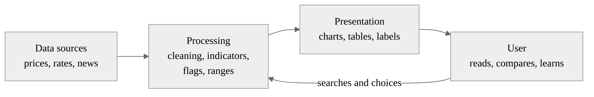

**Fig 2.1:** Basic Parts of a Market Decision-Support System

The data part collects raw prices. The processing part turns them into useful measures. The presentation part shows them. The user part is the person who reads, compares, and decides. If any part is weak, the whole system fails. Good data shown badly is not understood, and clear charts built on bad data mislead.

### 2.1.2 Information Visualisation

Information visualisation is the use of pictures, such as charts and graphs, to help people understand data. Munzner (2014) explains that a good visual design starts from the task the user wants to perform. The designer asks what data is shown, why the user needs it, and how it should be encoded as marks and colours. Few (2012) shows that simple, well-labelled tables and graphs help people compare values and notice trends with less effort, while decoration and clutter get in the way.

For a beginner investor, the main tasks are to see the direction of a price, judge whether a move is normal, and compare one company with another. This project therefore uses a line chart of closing prices with moving averages for direction, marks unusual days directly on the chart, and puts a short plain-language note next to each number.

### 2.1.3 Technology Acceptance Model

The Technology Acceptance Model (TAM) explains why people choose to use, or not use, a new system. Davis (1989) found that two beliefs matter most: perceived usefulness, meaning the belief that the system will help with the task, and perceived ease of use, meaning the belief that using it will not take much effort. A powerful system that looks hard to use may be ignored.

TAM guided two design choices. To support usefulness, the system brings NGX and United States stock data together in naira and dollars. To support ease of use, it uses plain words, a short guided tour, and help hints beside difficult terms.

### 2.1.4 User-Centred Design

Norman (2013) describes good design as design that makes clear what can be done, shows the result of each action, and helps the user recover from mistakes. He stresses feedback, visible controls, and a match between the system and how people think. In this project, every page shows loading and error states, every flag explains why it appeared, and missing values are written as "Not stated" rather than hidden or shown as zero.

### 2.1.5 Behavioural Finance

Classical finance assumes people make rational choices with all the facts. Behavioural finance studies how real people decide. Kahneman (2011) describes two modes of thinking: a fast, automatic mode and a slow, careful mode. Under pressure or uncertainty, people rely on the fast mode and on mental shortcuts, which can lead to errors such as reacting too strongly to recent news.

Barber and Odean (2000) studied the accounts of tens of thousands of households at a discount broker. They found that the households that traded most earned clearly lower net returns than those that traded least, and they linked this to overconfidence. This supports the design aim of the present system: to slow the user down and help them read, rather than to encourage frequent trading.

### 2.1.6 Market Efficiency and the Limits of Forecasting

Fama (1970) set out the efficient market hypothesis, which says that share prices quickly reflect the information available. If this holds even partly, then past prices alone cannot reliably predict future prices. This is an important limit for any forecast feature. In this project, the price-range feature is built and labelled as a picture of the spread of past outcomes, not as a prediction.

### 2.1.7 The Lognormal Price Model

A common model in finance treats the daily change in the logarithm of a price as random, with a steady average and spread. Under this model, future prices follow a lognormal distribution (Hull, 2022). Prices cannot fall below zero, and the range of likely outcomes widens with the square root of time. If a share's average daily log return is μ and its daily standard deviation is σ, then after T trading days the typical (median) price is:

\[ P_{\text{typical}} = P_0 \, e^{\mu T} \]

and a band that contains about 80% of outcomes runs from

\[ P_{\text{weaker}} = P_0 \, e^{\mu T - z\sigma\sqrt{T}} \quad\text{to}\quad P_{\text{stronger}} = P_0 \, e^{\mu T + z\sigma\sqrt{T}} \]

where \(P_0\) is the latest closing price and \(z \approx 1.2816\) is the point of the standard normal distribution that leaves 10% in each tail. The project uses this model because it is standard, simple to explain, and honest about spread. Its main weakness is that it assumes the past pattern continues.

### 2.1.8 Anomaly Detection

An anomaly is a data point that does not fit the normal pattern. Chandola, Banerjee, and Kumar (2009) group detection methods into families, including statistical methods and methods that isolate or separate points. Two methods are used here.

**The three-sigma rule** is a statistical method. It measures the average daily return and its standard deviation, and it marks any day whose move is more than three standard deviations from that average. It is simple and easy for an examiner or user to check by hand.

**Isolation Forest** was proposed by Liu, Ting, and Zhou (2008). It builds many random trees. Each tree repeatedly picks a feature and a random split value. Unusual points are isolated after only a few splits, so they have short average path lengths. The method works on small random samples, so it is fast, and it can consider several features at once, such as return, size of move, trading volume, and the day's price range.

Showing both methods side by side lets a user see where a simple rule and a machine-learning model agree or disagree.

### 2.1.9 Liquidity

Liquidity describes how easily an asset can be sold at a fair price. Amihud (2002) measured illiquidity by how much a share's price moves for each unit of money traded. He found that less liquid shares tend to carry higher expected returns as payment for the risk of being hard to sell. For a beginner, the key lesson is simpler. A share with very little daily trading may be a liquidity trap: the buyer cannot sell without waiting, cutting the price, or both. The system turns this into a plain warning based on the share's own trading activity.

### 2.1.10 Market Capitalisation versus Share Price

Share price is the cost of one unit. Market capitalisation is that price multiplied by the number of shares, so it measures the size of the whole company. Lusardi and Mitchell (2014) show that many adults lack even simple financial facts. Comparing two listings by unit price is one such error. A ₦10 share in a small company is not a bargain next to a ₦1,000 share in a large one. This project therefore shows market capitalisation on company pages and teaches the difference in the Learn section.

### 2.1.11 Financial Literacy

Lusardi and Mitchell (2014) review evidence from many countries showing that basic financial knowledge, such as interest, inflation, and diversification, is low among many adults, and that higher literacy is linked to better planning and saving. This supports adding teaching material inside the tool itself rather than assuming users already understand the terms.

## 2.2 Review of Related Literature

This section reviews earlier works whose ideas or findings relate directly to this project.

**Barber and Odean (2000)** examined trading records of about 66,000 households at a United States discount broker between 1991 and 1996. Households that traded most often had much lower net returns than the market and than households that traded less. The authors explained the result by overconfidence. This work shows that easier access to trading does not by itself produce better outcomes, and it supports tools that encourage understanding over activity.

**Davis (1989)** developed and tested scales for perceived usefulness and perceived ease of use. In studies of real users, both beliefs were linked to actual use of software, with usefulness having the stronger link. The study gives a basis for designing the market visualizer around clear value and low effort.

**Few (2012)** offers practical guidance for designing tables and graphs that communicate numbers clearly. The work argues for removing clutter, choosing the right chart for the comparison being made, and labelling directly. The project applies this to its charts, cards, and boards.

**Munzner (2014)** provides a framework for analysing visualisation designs by asking what data is shown, why the user needs it, and how it is shown. The framework helped decide which views the system needed, such as a trend view, a comparison board, and a range view.

**Norman (2013)** sets out principles of user-centred design, including visibility, feedback, and recovery from error. The project follows these by always showing loading, empty, and error states, and by explaining every flag.

**Kahneman (2011)** summarises research on how people decide under uncertainty, including the use of mental shortcuts and the tendency to overreact to vivid information. This supports careful wording around unusual-day flags and forecasts, so that they do not trigger hasty action.

**Fama (1970)** reviewed evidence that share prices respond quickly to new information, making price prediction from past prices unreliable. This study informed the decision to present forecasts only as ranges with clear warnings.

**Liu, Ting, and Zhou (2008)** introduced Isolation Forest and showed that isolating anomalies with random trees is accurate and fast compared with methods that model normal points first. The project implements the method for daily price data.

**Chandola, Banerjee, and Kumar (2009)** surveyed anomaly-detection methods across many fields and explained their assumptions and limits. The survey supports pairing a simple statistical rule with a machine-learning method, since each has different strengths.

**Amihud (2002)** introduced a simple measure of illiquidity based on daily price moves and trading value, and showed that illiquidity affects expected returns. The project's liquidity warnings are based on the same idea, adapted into a plain warning for beginners.

**Hull (2022)** presents the lognormal property of share prices used throughout financial modelling. The project's price-range feature uses this model.

**Lusardi and Mitchell (2014)** reviewed international evidence that financial literacy is low and that it matters for financial outcomes. This supports the Learn section.

**Demirguc-Kunt et al. (2022)** report World Bank Global Findex data showing rising account ownership and digital payments in developing economies, while gaps remain. This shows that digital access is growing, so the quality of digital tools matters more.

## 2.3 Summary of Related Literature and Knowledge Gap

**Table 2.1:** Summary of Related Literature

| S/N | Author(s) and Year | Focus | Method | Key Finding | Gap Relevant to This Project |
|---|---|---|---|---|---|
| 1 | Barber & Odean (2000) | Retail trading outcomes | Analysis of household broker records | Heavy traders earned lower net returns; overconfidence | No tool proposed to support careful reading |
| 2 | Davis (1989) | Technology acceptance | Survey scales and user studies | Usefulness and ease of use predict use | Not specific to market tools or Nigerian users |
| 3 | Few (2012) | Table and graph design | Design guidance | Clear, simple charts aid comparison | General; no market or local focus |
| 4 | Munzner (2014) | Visualisation design | Analytical framework | Design should start from user tasks | Framework only; no investor system |
| 5 | Norman (2013) | User-centred design | Design principles | Feedback and visibility build trust | General; not applied to finance |
| 6 | Kahneman (2011) | Judgement under uncertainty | Review of experiments | Shortcuts cause predictable errors | No interface solution |
| 7 | Fama (1970) | Market efficiency | Review of evidence | Past prices predict poorly | Does not address how to show uncertainty to beginners |
| 8 | Liu et al. (2008) | Anomaly detection | Algorithm and experiments | Isolation Forest is fast and accurate | Not applied to NGX data or explained to users |
| 9 | Chandola et al. (2009) | Anomaly detection survey | Literature survey | Methods have different assumptions | No investor-facing comparison |
| 10 | Amihud (2002) | Liquidity | Empirical finance | Illiquidity affects returns | Not turned into a beginner liquidity-trap warning |
| 11 | Hull (2022) | Price models | Textbook | Lognormal price model | Not turned into plain-language ranges |
| 12 | Lusardi & Mitchell (2014) | Financial literacy | Review of surveys | Literacy is low and matters | No in-tool teaching of market cap versus share price |
| 13 | Demirguc-Kunt et al. (2022) | Financial inclusion | Global survey | Digital access is rising | Access without understanding not addressed |

**Knowledge gap.** The reviewed works explain why beginners struggle, how good visual design helps, how to detect unusual data, and how to model price ranges. However, these ideas are not brought together in a single tool for Nigerian-oriented beginners. Existing market tools are mostly foreign-first. They show a share price without saying that company size is market capitalisation, not the price of one share. They rarely warn about a liquidity trap, where a listing is hard to sell. They either avoid the future entirely or offer single-number targets. No reviewed work combines NGX data in naira, lessons that compare companies by market cap rather than price, honest liquidity warnings that refuse to invent missing data, a side-by-side comparison of a simple rule and a machine-learning anomaly method, a range-based outlook with clear warnings, and built-in lessons. This project addresses that gap.

<!-- page break -->

# CHAPTER THREE

# METHODOLOGY AND SYSTEM ANALYSIS

## 3.1 Introduction

This chapter studies how beginner investors currently get and read market information, identifies the weaknesses of that practice, explains the development method chosen, and describes the proposed system with diagrams.

### 3.1.2 Analysis of the Existing System

There is no single "existing system" in the sense of one organisation's software. Instead, a Nigerian beginner investor today uses a mix of tools. The common pattern is as follows:

1. The user hears about a company on social media, from friends, or in the news.
2. The user checks the price on the NGX website, a broker app, or a financial news page.
3. For a chart or indicators, the user opens a foreign charting or finance site, where NGX coverage may be missing or limited.
4. For the naira-to-dollar rate, the user checks a separate site.
5. For company news, the user searches the web.
6. The user decides with little or no explanation of what the numbers mean.

**Table 3.1:** Existing Tools Used by Nigerian Beginners and Their Gaps

| Tool type | What it offers | Main gap for a beginner |
|---|---|---|
| Exchange website | Official prices, announcements | Little charting or explanation; price shown without market cap teaching |
| Broker mobile apps | Prices, buy and sell orders | Focus on trading; little teaching; thin listings not flagged as a liquidity trap |
| Foreign charting and finance sites | Rich charts and indicators | Foreign-first; thin NGX coverage; assumes expertise; unit price leads the screen |
| Newspaper and business sites | News and commentary | Not linked to price data |
| Social media | Fast tips and opinions | Mixed quality; often confident single-number targets; cheap-looking names pushed without size or liquidity |

Fig 3.1 shows how data flows in this existing practice.

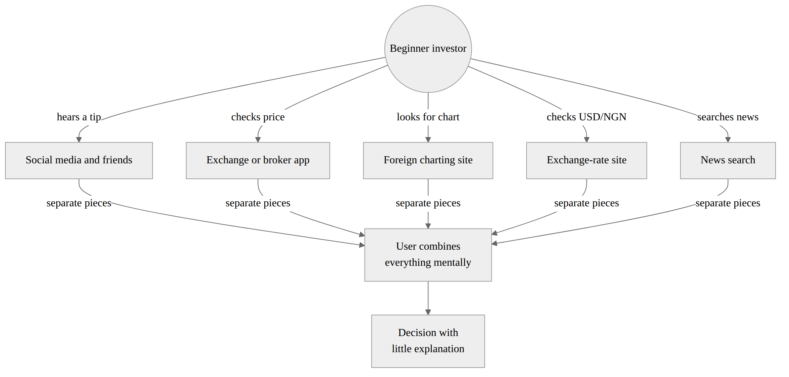

**Fig 3.1:** Data Flow Diagram of the Existing Practice

### 3.1.3 Weaknesses of the Existing System

1. **Fragmentation.** Data sits in five or more places. The user does the joining work and can easily make mistakes.
2. **Foreign focus.** Rich tools favour foreign markets and dollars. NGX listings and naira context are second-class or missing.
3. **No explanation.** Indicators and percentages appear without plain meaning, so beginners cannot judge whether a move is normal.
4. **Share price treated as size.** Boards and apps lead with the unit price, so a ₦10 share looks cheaper than a ₦1,000 share even when the ₦10 company is smaller.
5. **Liquidity trap.** Users are rarely told that a share trades so little that selling could be slow, costly, or almost impossible. A cheap-looking listing can trap the buyer.
6. **Misleading empty values.** Missing data is sometimes shown as zero, which a beginner may read as a real value.
7. **Poor handling of the future.** Tools either say nothing about possible outcomes or, on social media, offer confident targets that hide uncertainty.
8. **No learning path.** Users must find lessons elsewhere and connect them to real data on their own.

### 3.2.1 Methodology Adopted

The project used an **iterative, prototype-driven development methodology**. This approach is close to the evolutionary prototyping model. A working version is built early and improved in repeated cycles of planning, building, testing, and review, as shown in Fig 3.2.

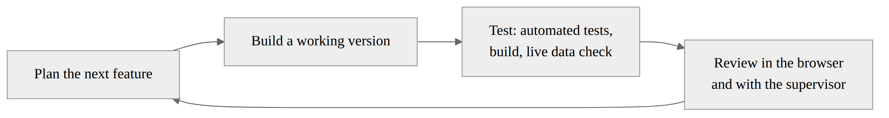

**Fig 3.2:** Iterative Development Cycle Adopted

The method was chosen for these reasons:

1. **Uncertain data sources.** Free market data sources differ in coverage, format, and limits. Building early showed which sources worked before the design was fixed.
2. **Interface needs to be seen.** Whether an explanation is clear can only be judged by looking at it on screen. Each cycle ended with a browser check.
3. **Safe change.** Automated tests were run after each cycle, so later changes did not break earlier features.
4. **Single developer.** A light, iterative process suits one developer better than a heavy, document-first method.

The cycles followed this order:

1. core server and United States stock charts;
2. live USD/NGN exchange-rate integration;
3. NGX market board, company pages, and naira display;
4. indicators and unusual-day flags (three-sigma and Isolation Forest);
5. sign-up, sign-in, and the watchlist with row-level security;
6. liquidity warnings and the liquidity board;
7. the possible price range (forecast) for NGX and United States equities;
8. the Learn section, glossary, and guided tour; and
9. security hardening, error fixes, and deployment.

Requirements were gathered from the literature in Chapter Two, from a study of existing tools, and from the author's own use of these tools as a beginner investor. The evaluation was technical. It used automated unit and API tests, production builds, checks against live data, and modelled examples. No survey or user experiment was carried out.

### 3.2.2 Analysis of the Proposed System

The proposed system, **Nexora Markets**, is a web application that brings the scattered pieces into one guided interface. Its main parts are:

1. **Home.** A starting page with a live market overview, the USD/NGN rate, and links to each section.
2. **Stocks.** Search for United States shares and view a chart, indicators, unusual-day flags, company details, news, liquidity, and a possible range.
3. **NGX.** A board of NGX equities in naira, the NGX All-Share Index, company pages with price history, a liquidity board, and NGX news.
4. **Forecast.** One page where the user picks a United States share or NGX listing and a horizon of one, two, three, or five years to see a weaker, typical, and stronger price.
5. **Learn.** Illustrated lessons, a "start here" path, and a glossary, including how to compare size by market cap and how to notice a liquidity trap.
6. **Account.** Sign-up, sign-in, and a private watchlist.

Fig 3.3 shows the data flow of the proposed system.

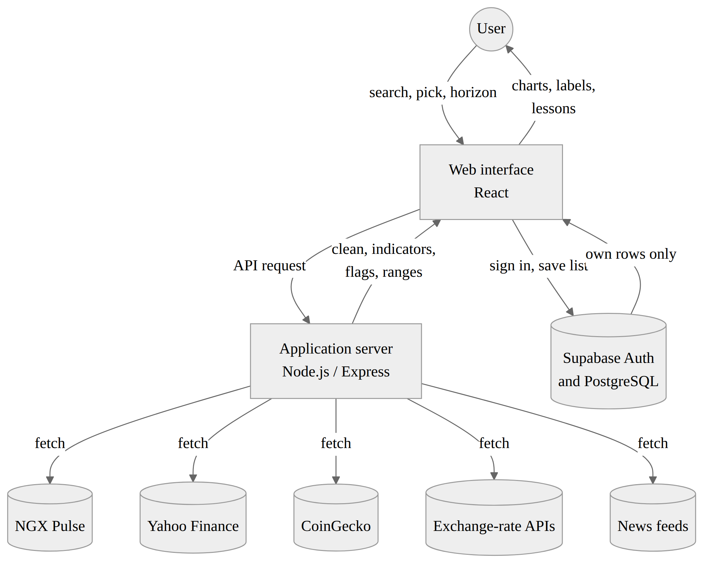

**Fig 3.3:** Data Flow Diagram of the Proposed System

The server does the processing. It fetches data from NGX Pulse (n.d.), Yahoo Finance (n.d.), and public exchange-rate services, then normalises each source into one shape, removes bad rows, and computes indicators, anomaly flags, liquidity measures, and price ranges on the series it actually received. It never fills gaps with made-up prices. The client draws the results and adds plain-language explanations. Accounts and the stocks watchlist are stored in Supabase (n.d.).

### 3.2.3 Use Case Diagram

The system has two actors. A **visitor** can use all market and learning features without an account. A **registered user** can do everything a visitor can, and can also keep a stocks watchlist. Supabase is an external system that handles accounts. There is no administrator role in the application. Database settings are managed in the Supabase dashboard.

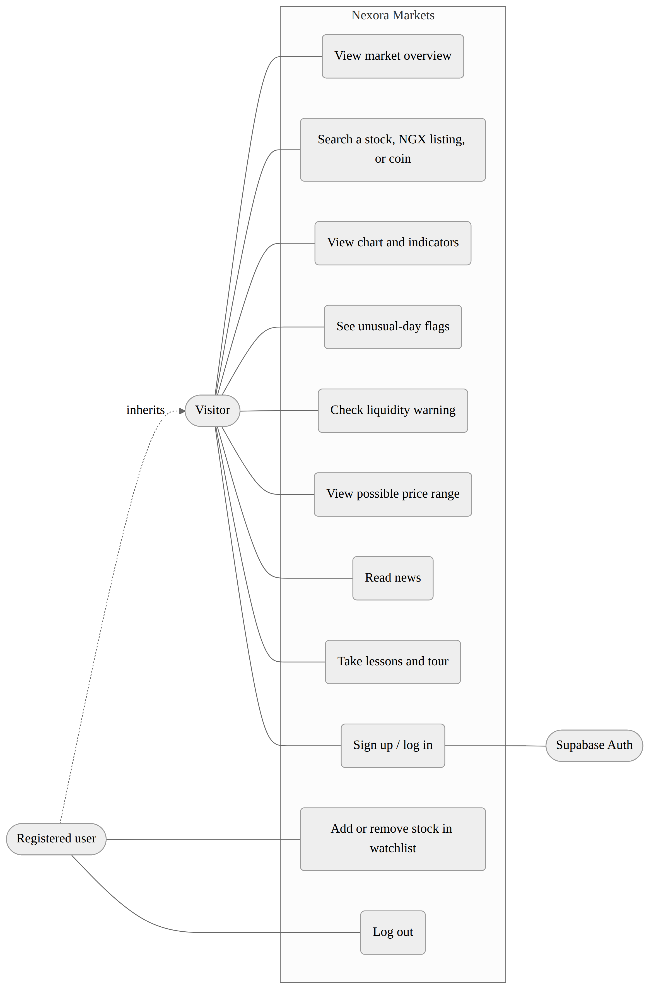

**Fig 3.4:** Use Case Diagram of the Proposed System

### 3.2.4 Justification of the Proposed System

1. **One place instead of four.** NGX, United States stocks, the exchange rate, and news are all reachable from one menu.
2. **Local first.** NGX prices are shown in naira, and the NGX section is a first-class part of the system.
3. **Explained numbers.** Each chart, flag, and range has a short plain-language note and an optional help hint.
4. **Two views of "unusual".** Showing a simple rule and a machine-learning model together helps users and examiners see how each works.
5. **Honest liquidity-trap warnings.** The liquidity board flags listings that may be hard to sell and refuses to show values that the sources do not confirm.
6. **Size, not unit price.** Company pages show market capitalisation, and Learn teaches that a cheap share is not a small or large company by itself.
7. **A range, not a promise.** The forecast shows three outcomes and says clearly that it can be wrong.
8. **Learning built in.** Lessons sit next to the tools they explain.
9. **Low cost and easy access.** The system runs in any modern browser and uses free or low-cost data.
10. **Security by design.** Each user's watchlist is protected by database rules, and no secret keys are sent to the browser.

### 3.3.3 High Level Model of the Proposed System

Fig 4.1 shows the high-level model. The system has three tiers: a presentation tier in the browser, an application tier on the server, and a data tier made up of external market sources and the Supabase database.

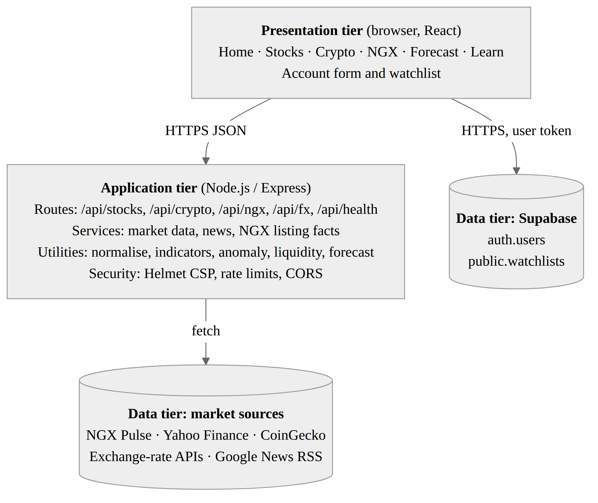

**Fig 4.1:** High Level Model of the Proposed System

<!-- page break -->

# CHAPTER FOUR

# SYSTEM DESIGN AND IMPLEMENTATION

## 4.1 Objective of the Design

The design aims to:

1. give users one simple menu for every market and for learning;
2. show NGX data in naira next to foreign data;
3. explain every number in plain language where it appears;
4. flag unusual days, a liquidity trap, and possible ranges honestly, without inventing data, and show market capitalisation so users do not compare companies by share price;
5. let users keep a private watchlist safely; and
6. stay fast and usable on ordinary phones and laptops.

## 4.2 Control Center / Main Menu

The main menu is the navigation bar at the top of every page. It holds the logo, links to **Home, Stocks, NGX, Forecast,** and **Learn**, the live USD/NGN rate bar, a light and dark theme switch, and **Log in** and **Sign up** buttons. A signed-in user sees a **Log out** option instead. The Home page acts as the control centre. It shows a short welcome, a market overview board, and cards that lead into each section. A **Take a tour** button walks new users through the screen.

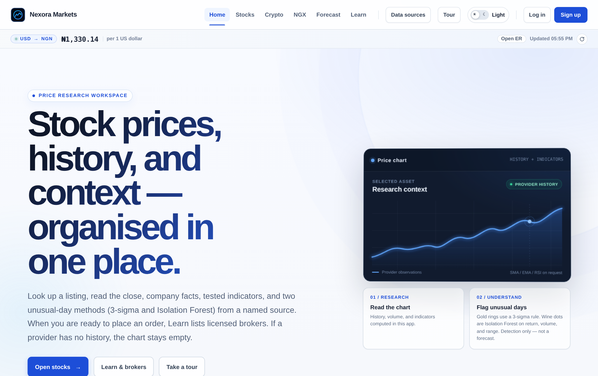

**Fig 4.2:** Main Menu (Home Page)

## 4.3 Sub-Menus

### 4.3.1 Stocks

The user types a company name or ticker. The page shows the company name, last price, daily change, and market capitalisation; a chart with selectable periods, moving averages, and RSI; an option to overlay a second symbol from a common 0% start; condition labels; unusual-day markers with reasons such as "big rise" or "thin volume"; company details; a liquidity flag for a possible liquidity trap; a possible range; and recent news. An **Add to watchlist** button saves the symbol when the user is signed in.

### 4.3.2 NGX

The NGX page shows the NGX All-Share Index and a sortable board of listed equities in naira. Choosing a company opens its page with price history, chart, company details, news, a liquidity flag, and its possible range. A **Liquidity** button opens a board that ranks listings by how easy they are to sell, so a liquidity trap is visible before a user treats a cheap price as a bargain. Red and amber tags mark the hardest cases. Where a source confirms how a company was listed, such as by initial public offering or by introduction, the tag shows this. Otherwise it reads "Not stated".

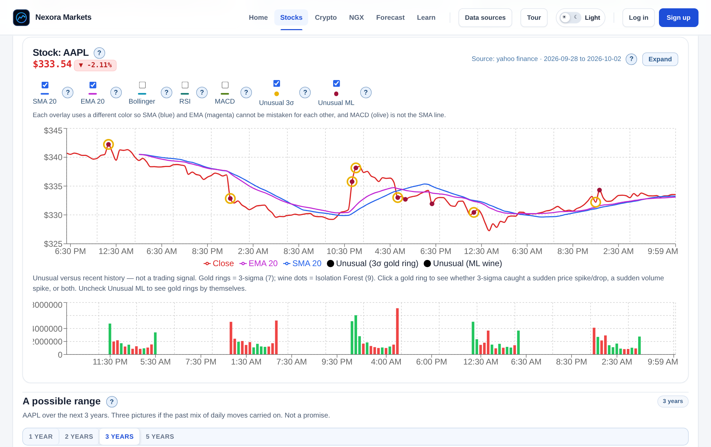

**Fig 4.3:** Stock and NGX Detail Page (AAPL chart with SMA 20, EMA 20, three-sigma gold rings, and Isolation Forest dots)

### 4.3.3 Forecast

The user picks a market (US stock or NGX), picks a name, and chooses one, two, three, or five years. The page then shows three cards labelled **Weaker**, **Typical**, and **Stronger**. Each card gives a price and its percentage change from the latest close. An animated track shows where the typical price sits between the weaker and stronger prices. A history line states how many daily closes were used and over what dates. A note warns that the picture can be wrong because it does not know investor mood, the wider economy, the company's own market, or whether the business grows or declines.

**Worked example (DANGCEM, 2 October 2026).** The model used 3,650 daily closes from 2 August 2011 to 2 October 2026. The latest close was ₦1,066.70. The average daily log return was about 0.000625, and the daily standard deviation was about 0.0208.

- For one year (T = 252 trading days), the system showed ₦817.04 (weaker, −23.4%), ₦1,248.62 (typical, +17.1%), and ₦1,908.16 (stronger, +78.9%).
- For three years (T = 756), it showed ₦820.70 (−23.1%), ₦1,710.82 (+60.4%), and ₦3,566.35 (+234.3%).

The band widens with time because spread grows with the square root of T while the typical value grows with T. Over the history, the share rose about 16.2% a year, close to the 17.1% a year implied by the model.

**Worked example (AAPL, 2 October 2026, shown in Fig 4.4).** When the screenshots were taken on 4 October 2026, the NGX Pulse key had returned to its Free plan, which serves only the last seven sessions. The NGX range therefore showed "Need at least 252 daily closes; this series has 7" instead of guessing, which is the intended behaviour. Fig 4.4 uses Apple (AAPL) instead. The model used 2,511 daily closes from 6 October 2016 to 2 October 2026, with a latest close of $333.69.

- For one year, the system showed $294.12 (weaker, −11.9%), $427.23 (typical, +28.0%), and $620.58 (stronger, +86.0%).
- For three years, it showed $366.83 (+9.9%), $700.32 (+109.9%), and $1,337.00 (+300.7%).

Here even the weaker three-year price sits above today's price. That is not a promise of gain. It only reflects that Apple rose about 28% a year over the past decade, and the model assumes that mix of daily moves carries on. This is exactly the weakness stated in Section 2.1.6 and in the note under every range.

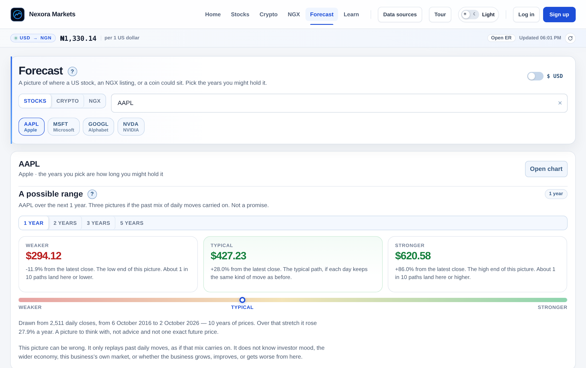

**Fig 4.4:** Forecast Page (AAPL, 1 year)

### 4.3.4 Learn

The Learn page opens with a "Start here" path of four steps. Below it are numbered lessons, each with a small animated picture. The lessons cover reading a price, reading a chart, percentages, how to read an earnings report, comparing companies by market capitalisation rather than share price, how to spot a strong company, indicators, the possible range, unusual days, the liquidity trap, the naira, and risk. A glossary of chips lets the user tap a term to see its meaning. Lessons are written in short, simple sentences.

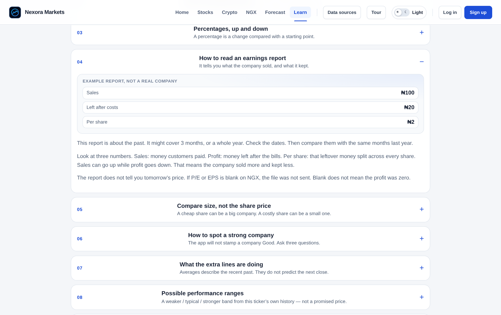

**Fig 4.5:** Learn Page (the earnings-report lesson open)

### 4.3.5 Account (Login and Sign-Up)

The **Log in** and **Sign up** buttons open one form with email and password fields and a switch between "Log in" and "Create account". New users confirm their email through a link sent by Supabase. After logging in, the user's stocks watchlist appears on the Stocks page and the **Add to watchlist** buttons become active. If the Supabase keys are not set, the account buttons are hidden and the rest of the system still works.

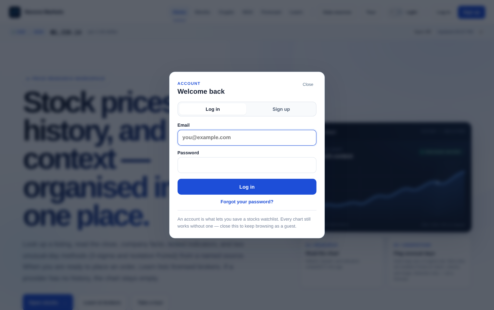

**Fig 4.6:** Login and Sign-Up Form

## 4.4 System Specification

### 4.4.1 Database Development Tool

The system uses **Supabase**, a hosted platform built on **PostgreSQL**. Supabase was chosen because:

1. it provides ready-made, secure email sign-up and sign-in;
2. it supports PostgreSQL row-level security, so each user's data is protected by the database itself;
3. the browser can talk to it directly with a public "publishable" key, without the application server handling passwords; and
4. it has a free tier suitable for a student project.

Market prices are not stored in the database. They are fetched from external sources and held briefly in a memory cache on the server.

### 4.4.2 Database Design

The application owns one table, `public.watchlists`. User accounts live in the `auth.users` table that Supabase manages. Each user has at most one watchlist row.

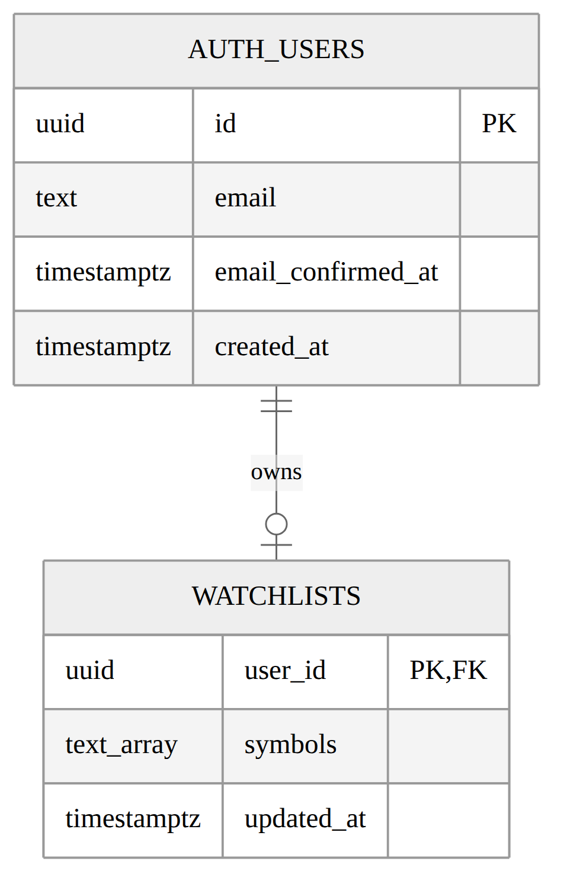

**Fig 4.7:** Entity Relationship Diagram

**Table 4.1:** Watchlists Table (`public.watchlists`)

| S/N | Field name | Data type | Constraint | Description |
|---|---|---|---|---|
| 1 | user_id | uuid | Primary key; foreign key to auth.users(id); delete cascade | Owner of the watchlist |
| 2 | symbols | text[] | Not null; default empty; at most 12 items; each must match `^[A-Z0-9][A-Z0-9./-]{0,11}$` | Saved ticker symbols |
| 3 | updated_at | timestamptz | Not null; default now(); set by trigger on update | Time of last change |

**Table 4.2:** User Account Fields Used from Supabase Auth (`auth.users`)

| S/N | Field name | Data type | Description |
|---|---|---|---|
| 1 | id | uuid | Unique user identifier |
| 2 | email | text | Sign-in email address |
| 3 | email_confirmed_at | timestamptz | Time the email was confirmed |
| 4 | created_at | timestamptz | Time the account was created |

Passwords are stored by Supabase as secure hashes and are never seen by the application.

Four row-level security policies (select, insert, update, and delete) each check that `auth.uid() = user_id`. A signed-in user can therefore read and change only their own row, even if someone tampers with the browser code. A check constraint limits the list to 12 valid tickers, so the table cannot be misused as free storage.

### 4.4.3 Program Modules

**Table 4.3:** Program Modules

| S/N | Module | Location | Function |
|---|---|---|---|
| 1 | Server entry and app setup | `backend/src/server.js`, `app.js` | Starts the server, applies security middleware, mounts routes, serves the built client |
| 2 | Security | `backend/src/security.js` | Content Security Policy, rate limits |
| 3 | Stock routes | `backend/src/routes/stocks.js` | Quotes, search, company info, history, news, outlook |
| 4 | NGX routes | `backend/src/routes/ngx.js` | Equities board, market index, company, prices, history, news, outlook |
| 5 | FX route | `backend/src/routes/fx.js` | USD/NGN rate |
| 6 | Market data service | `backend/src/services/marketData.js` | Fetches and caches data from each provider |
| 7 | News service | `backend/src/services/news.js` | Fetches headlines |
| 8 | NGX listing facts | `backend/src/services/ngxSellFactors.js` | Loads confirmed listing method, float, and holder facts |
| 9 | Normalisation | `backend/src/utils/normalize.js` | Converts every source into one clean price shape |
| 10 | Market maths | `backend/src/utils/marketMath.js` | Moving averages, changes, condition labels |
| 11 | Anomaly detection | `backend/src/utils/anomaly.js` | Three-sigma rule and Isolation Forest |
| 12 | Liquidity | `backend/src/utils/liquidity.js` | Liquidity measures and red/amber/ok tone |
| 13 | Forecast | `backend/src/utils/forecast.js` | Lognormal weaker/typical/stronger range |
| 14 | App shell and Home | `frontend/src/App.jsx` | Menu, routing, Home page, watchlist |
| 15 | Market pages | `frontend/src/pages/StockPage.jsx`, `NgxPage.jsx` | Detail pages for US stocks and NGX |
| 16 | Forecast page | `frontend/src/pages/ForecastPage.jsx` | Market, name, and horizon pickers |
| 17 | Learn page | `frontend/src/pages/LearnPage.jsx`, `lib/guideContent.js` | Lessons, path, glossary |
| 18 | Chart | `frontend/src/components/MarketChart.jsx` | Price chart with indicators and markers |
| 19 | Outlook panel | `frontend/src/components/OutlookPanel.jsx` | Range cards and track |
| 20 | Liquidity board and flag | `frontend/src/components/LiquidityBoard.jsx`, `LiquidityFlag.jsx` | Ranked board and per-asset warning |
| 21 | Authentication | `frontend/src/components/AuthModal.jsx`, `lib/supabase.js` | Sign-up, sign-in, session |
| 22 | Guided tour | `frontend/src/components/GuidedTour.jsx` | Step-by-step screen tour |
| 23 | Database schema | `supabase/schema.sql` | Table, policies, constraint, trigger |

### 4.4.4 Input Specification

**Table 4.4:** Input Specification

| S/N | Input | Where entered | Format and checks |
|---|---|---|---|
| 1 | Stock search text | Stocks page | Free text; sent to search endpoint |
| 2 | Stock symbol | URL / picker | Uppercase ticker, validated on server |
| 3 | NGX symbol | NGX board / picker | Uppercase ticker from the NGX list |
| 4 | Chart period | Detail pages | One of the offered periods |
| 5 | Forecast horizon | Forecast page and panels | Only 1, 2, 3, or 5 accepted (`parseOutlookYears`) |
| 6 | Email | Log-in / sign-up form | Valid email format |
| 7 | Password | Log-in / sign-up form | Minimum length set in Supabase |
| 8 | Watchlist symbol | Add to watchlist button (Stocks page) | Ticker pattern; at most 12 symbols |
| 9 | Theme choice | Theme switch | Light or dark, saved in the browser |

### 4.4.5 Output Specification

**Table 4.5:** Output Specification

| S/N | Output | Description |
|---|---|---|
| 1 | Market overview | Board of current quotes and daily changes |
| 2 | USD/NGN bar | Current exchange rate and source |
| 3 | Price chart | Closing-price line with moving averages and unusual-day markers |
| 4 | Condition labels | Plain notes on trend and recent move |
| 5 | Unusual-day list | Date, move, volume ratio, which method flagged it, and why |
| 6 | Liquidity flag and board | Red, amber, or ok tone with a reason; "Not stated" for missing facts |
| 7 | Possible range | Weaker, typical, and stronger prices with percentages, history line, and warning |
| 8 | Company details | Name, sector, market capitalisation, and other confirmed facts |
| 9 | News | Recent headlines with source and time |
| 10 | Lessons and glossary | Illustrated lessons and term meanings |
| 11 | Watchlist | The signed-in user's saved stock symbols |
| 12 | Messages | Loading, empty, and error states in plain words |

## 4.5 System Implementation

### 4.5.1 Hardware Requirements

**Table 4.6:** Hardware Requirements

| Item | Minimum (user) | Recommended (development) |
|---|---|---|
| Device | Any smartphone, tablet, or computer with a modern browser | Laptop or desktop |
| Processor | Any current mobile or desktop processor | Dual-core 2.0 GHz or better |
| Memory (RAM) | 2 GB | 8 GB |
| Storage | None beyond the browser | 2 GB free for code and packages |
| Network | Internet connection | Stable broadband internet |

### 4.5.2 Software Requirements

**Table 4.7:** Software Requirements

| Item | Software used |
|---|---|
| Operating system | Any (developed on Linux) |
| Browser | Current Chrome, Edge, Firefox, or Safari |
| Runtime | Node.js 22 to 24 |
| Frontend | React 19, Vite 8, Recharts |
| Backend | Express 5, Axios, yahoo-finance2, Helmet, express-rate-limit, compression, CORS |
| Database and auth | Supabase (PostgreSQL), `@supabase/supabase-js` |
| Testing | Vitest, Supertest, ESLint |
| Hosting | Railway (Nixpacks build, health check at `/api/health`) |
| Version control | Git and GitHub |
| Editor | Cursor / Visual Studio Code |

### 4.5.3 Program Development

The program was developed in the cycles described in Section 3.2.1. The work was split into a `frontend` folder for the React client, a `backend` folder for the Express server, and a `supabase` folder for the database script. A root `package.json` runs both parts together during development and builds the client for production. In production, the Express server serves both the API and the built client from one address.

Key implementation points:

1. **Normalisation.** Each provider returns data in a different shape. The normalise module turns all of them into rows of date, open, high, low, close, and volume, and drops rows with bad values. No missing candle is invented.
2. **Indicators.** Simple and exponential moving averages, RSI, and changes are computed on the server from the series actually returned.
3. **Anomaly detection.** For each day, the system builds four features: the return, the size of the return, volume compared with the 20-day median, and the day's high-low range. The three-sigma rule flags returns or volume ratios more than three standard deviations from the mean. Isolation Forest builds 80 random trees on samples of up to 256 days, using a fixed seed of 42 so that results can be repeated. A day is flagged when its score is in the top 5% and at least 0.55. Each flag carries plain reasons such as "spike", "dump", "volume", or "thin volume".
4. **Liquidity.** For each listing, the system compares a normal-sized sale with the money that traded that day. A sale worth at least one-tenth of the day's trading gives a red tone, and at least one-fortieth gives amber. The normal sale is ₦500,000 for NGX and $2,000 for US stocks. Facts such as free float or listing method are shown only where a confirmed source gives them.
5. **Forecast.** The server takes at least 252 daily closes, computes the mean and standard deviation of daily log returns, and applies the lognormal formulas from Section 2.1.7. If there is not enough history, it returns a clear "not enough history" message instead of a guess.
6. **Caching.** Responses from providers are cached in memory for a short time to stay within rate limits and load quickly.
7. **Authentication.** The browser uses Supabase with the PKCE sign-in flow and a publishable key. The watchlist is read and written directly under row-level security.

### 4.5.4 Choice of Programming Language

**JavaScript** was used for the whole system, on the browser with **React** and on the server with **Node.js** and **Express**. The reasons are:

1. one language across the client and server reduces context switching and lets code ideas be shared;
2. React makes it easy to build interactive pages from reusable components such as the chart and the outlook panel;
3. Vite gives fast development and small production builds;
4. Node.js handles many concurrent API requests well, which suits a data-fetching server;
5. a large set of libraries exists for charts, security, and testing; and
6. **SQL** (PostgreSQL) was used for the database schema and its security rules.

### 4.5.5 System Testing

Testing was done at three levels.

**Unit and API tests.** The backend has 57 automated tests in 8 files, run with Vitest and Supertest. All tests pass.

**Table 4.8:** Summary of Automated Tests

| S/N | Test file | What it checks |
|---|---|---|
| 1 | `api.test.js` | Health and FX routes; invalid forecast horizons rejected before any provider call |
| 2 | `normalize.test.js` | Converting provider data into clean rows; dropping bad rows |
| 3 | `indicators.test.js` | SMA, EMA, and RSI values; Isolation Forest and three-sigma flags on injected crashes and volume spikes |
| 4 | `marketMath.test.js` | Changes, condition labels, NGX slicing |
| 5 | `marketIntegrity.test.js` | No invented candles; series stay honest |
| 6 | `liquidity.test.js` | Liquidity measures and red/amber/ok tones |
| 7 | `ngxSellFactors.test.js` | Loading confirmed NGX listing facts; "Not stated" when missing |
| 8 | `forecast.test.js` | Log returns, horizon checks, range maths, insufficient-history cases |

**Build and code checks.** ESLint was run on the client with no errors, and the production build was completed with `npm run build`.

**Live checks in the browser.** Each feature was opened in the browser against live data. Checks included the AAPL one-year and three-year ranges, Learn lessons opening and closing (including market cap and liquidity), the log-in form, light and dark themes, and mobile widths. The DANGCEM worked example in Section 4.3.4 was checked by hand against the formulas when a paid NGX Pulse history window was available. On the Free plan, the same NGX range correctly showed "not enough history" instead of guessing. The screenshot pass found and fixed two display faults: the market-condition charts printed raw timestamps on their date axis, and the NGX Top Movers cards showed ₦0 when a card was built from price history without its quote. Both now show readable dates and the real price, or "—" when a price is missing.

### 4.5.6 Limitations of the System

1. Data can be delayed and depends on outside providers that may change or limit access. For example, NGX price history and the NGX forecast need a paid NGX Pulse plan; on the Free plan only the last seven sessions are available, and the NGX range shows a "not enough history" message.
2. Some NGX details, such as free float, holders, and listing method, are not available for every company. For example, 14 of the 50 largest listings are still "Not stated" for listing method.
3. The forecast assumes the past pattern of daily moves continues, so it cannot foresee news, policy changes, or company events.
4. Unusual-day flags describe the past only. They are not buy or sell signals.
5. There is no trading, portfolio tracking, or price alert.
6. There was limited time to carry out the research, so the effect on users was not measured with a human-subject study.

### 4.5.7 System Security

**Table 4.9:** Security Measures

| S/N | Threat | Measure |
|---|---|---|
| 1 | Reading or changing another user's watchlist | Row-level security policies on every operation |
| 2 | Abuse of the watchlist table | Check constraint: at most 12 valid tickers |
| 3 | Leaked secret keys | Only the public URL and publishable key reach the browser; the secret key and database URL are never used in the app or host settings |
| 4 | Password theft | Passwords handled only by Supabase; PKCE sign-in flow |
| 5 | Script injection | Helmet with a strict Content Security Policy that allows only known scripts and sources |
| 6 | Flooding the API | Rate limit of 600 requests per 15 minutes per client, and 120 per 5 minutes for NGX routes |
| 7 | Requests from unknown sites | CORS limited to allowed origins |
| 8 | Large request bodies | JSON body limit of 256 KB |
| 9 | Secrets in source control | `.env` files are ignored by Git |

### 4.5.8 Training

Users do not need formal training. The system teaches itself in three ways:

1. a short **guided tour** that highlights each part of the screen;
2. **help hints** next to difficult terms on every page; and
3. the **Learn** section, with a start-here path, illustrated lessons, and a glossary.

For a lecture or club setting, a facilitator can walk through the start-here path, then open one NGX company and explain its chart, flags, liquidity, and range.

### 4.5.9 Documentation

The project includes:

1. this report;
2. a project README with steps to install and run the system (`npm install`, then `npm run dev`);
3. technical notes on the framework and data sources in the `docs` folder;
4. the database script with comments in `supabase/schema.sql`;
5. comments in the source code where a rule is not obvious; and
6. the in-app Learn section and glossary as user documentation.

## 4.6 System Conversion

### 4.6.1 Changeover Procedures

System conversion is the move from an old way of working to a new system. The usual procedures are:

1. **Direct changeover.** The old method stops and the new system starts at once. It is fast and cheap, but risky if the new system fails.
2. **Parallel running.** The old and new methods run together for a period until the new one is trusted. It is safe but takes more effort.
3. **Pilot changeover.** The new system is given first to a small group, then to everyone.
4. **Phased changeover.** The new system is introduced one part at a time.

### 4.6.2 Recommended Procedure

For Nexora Markets, the **pilot changeover combined with parallel running** is recommended. The system should first be given to a small group, such as a class or an investment club. Members keep using their usual broker apps and exchange pages alongside it, so they can compare what they see. This lets prices be checked against official sources and lets feedback improve the explanations before wider release. Because the system does not handle money or trades, the risk of running in parallel is low.

<!-- page break -->

# CHAPTER FIVE

# SUMMARY, CONCLUSION AND RECOMMENDATIONS

## 5.1 Summary

This project set out to help Nigerian-oriented beginner investors read the market more easily. Chapter One described the problem: scattered, foreign-first tools that show prices without explaining them, that invite beginners to compare share prices instead of market capitalisation, and that leave a liquidity trap hidden. Chapter Two reviewed theory and earlier work on decision support, visualisation, technology acceptance, user-centred design, behavioural finance, market efficiency, price models, anomaly detection, liquidity, and financial literacy. It found that these ideas had not been combined in one tool for Nigerian beginners. Chapter Three analysed the existing practice, chose an iterative prototype-driven method, and modelled the proposed system. Chapter Four described the design and implementation of Nexora Markets: NGX and United States stock pages; unusual-day flags using three-sigma and Isolation Forest; liquidity warnings; a lognormal possible range; illustrated lessons; and a secure watchlist. The system passed 57 automated tests, built cleanly, and was checked against live data.

## 5.2 Conclusion

The project shows that one guided, locally aware web interface can bring NGX and foreign equity data together, show NGX prices in naira, and explain each number in plain language. It can stop a beginner comparing companies by share price instead of market capitalisation, and it can warn when a listing may be a liquidity trap. Showing a simple statistical rule beside a machine-learning model makes "unusual" easier to understand. Presenting the future as a weaker-typical-stronger range, with a clear warning, is more honest than a single target. Refusing to invent missing data keeps the tool trustworthy. Based on the literature and the technical evaluation, the system is likely to reduce the effort a beginner needs to read the market. However, its real effect on investors has not yet been measured.

## 5.3 Recommendations

1. Investor-education bodies and university finance clubs could pilot the system as a teaching aid.
2. Funding should be sought for an official NGX data licence to get timely and complete prices, free float, and holder data.
3. A formal user study should be carried out before any claim about effect on investor behaviour is made.
4. Users should treat the system as a learning and reading tool, not as financial advice, and should confirm prices with their broker before acting.

## 5.4 Contribution to Knowledge

1. A working, tested design that combines NGX data in naira with United States stocks in one beginner-oriented interface.
2. A practical side-by-side use of a three-sigma rule and Isolation Forest on daily market data, with plain-language reasons for each flag.
3. A liquidity-trap warning method for beginners that states missing facts as "Not stated" instead of guessing.
4. In-tool teaching that company size is market capitalisation, not the share price.
5. A plain-language presentation of a lognormal price range with explicit limits.
6. A model of lessons placed inside a market tool, next to the data they explain.

## 5.5 Suggestions for Further Studies

1. Carry out a controlled user study comparing beginners who use the system with those who use common existing tools, measuring understanding and confidence.
2. Add more forecast models, such as models with changing volatility, and compare how well each range held over time.
3. Add dividend history, financial statements, and sector comparison for NGX companies.
4. Build a mobile app with price alerts and offline lessons.
5. Translate lessons into Nigerian languages such as Igbo, Yoruba, and Hausa.
6. Test the anomaly flags against confirmed market events to measure how useful they are.

## 5.6 Contribution to Knowledge in the Field

To the field of computer science, the project contributes an example of applied software engineering for a local financial-literacy problem. It shows how a small full-stack system can combine data integration from several unreliable free sources, server-side statistics and machine learning, database-level security, and human-centred interface design. It also shows a development practice that values honesty in data display, never filling gaps with invented values. Other student and research projects can reuse that practice.

<!-- page break -->

# REFERENCES

> Verify every entry against the original source before printing. Replace "Retrieved October 4, 2026" with the date you actually accessed each website. Use hanging indent.

Amihud, Y. (2002). Illiquidity and stock returns: Cross-section and time-series effects. *Journal of Financial Markets, 5*(1), 31–56. https://doi.org/10.1016/S1386-4181(01)00024-6

Barber, B. M., & Odean, T. (2000). Trading is hazardous to your wealth: The common stock investment performance of individual investors. *The Journal of Finance, 55*(2), 773–806. https://doi.org/10.1111/0022-1082.00226

Chandola, V., Banerjee, A., & Kumar, V. (2009). Anomaly detection: A survey. *ACM Computing Surveys, 41*(3), Article 15. https://doi.org/10.1145/1541880.1541882

Davis, F. D. (1989). Perceived usefulness, perceived ease of use, and user acceptance of information technology. *MIS Quarterly, 13*(3), 319–340. https://doi.org/10.2307/249008

Demirguc-Kunt, A., Klapper, L., Singer, D., & Ansar, S. (2022). *The Global Findex Database 2021: Financial inclusion, digital payments, and resilience in the age of COVID-19*. World Bank. https://doi.org/10.1596/978-1-4648-1897-4

Fama, E. F. (1970). Efficient capital markets: A review of theory and empirical work. *The Journal of Finance, 25*(2), 383–417. https://doi.org/10.2307/2325486

Few, S. (2012). *Show me the numbers: Designing tables and graphs to enlighten* (2nd ed.). Analytics Press.

Hull, J. C. (2022). *Options, futures, and other derivatives* (11th ed.). Pearson.

Kahneman, D. (2011). *Thinking, fast and slow*. Farrar, Straus and Giroux.

Liu, F. T., Ting, K. M., & Zhou, Z.-H. (2008). Isolation forest. In *2008 Eighth IEEE International Conference on Data Mining* (pp. 413–422). IEEE. https://doi.org/10.1109/ICDM.2008.17

Lusardi, A., & Mitchell, O. S. (2014). The economic importance of financial literacy: Theory and evidence. *Journal of Economic Literature, 52*(1), 5–44. https://doi.org/10.1257/jel.52.1.5

Munzner, T. (2014). *Visualization analysis and design*. CRC Press.

NGX Pulse. (n.d.). *NGX market data API*. Retrieved October 4, 2026, from https://www.ngxpulse.ng/

Nigerian Exchange Group. (n.d.). *Market data and investor resources*. Retrieved October 4, 2026, from https://ngxgroup.com/

Norman, D. A. (2013). *The design of everyday things* (Revised and expanded ed.). Basic Books.

Securities and Exchange Commission Nigeria. (n.d.). *Investor education*. Retrieved October 4, 2026, from https://sec.gov.ng/

Supabase. (n.d.). *Row level security*. Retrieved October 4, 2026, from https://supabase.com/docs/guides/database/postgres/row-level-security

Yahoo Finance. (n.d.). *Market data*. Retrieved October 4, 2026, from https://finance.yahoo.com/

<!-- page break -->

# APPENDIX A: SOURCE CODES

> The full source code is in the project repository. The key modules are reproduced below.

## A.1 Possible Price Range (`backend/src/utils/forecast.js`)

```javascript
/** Inverse of the standard normal CDF at 10% / 90%. */
export const Z_10_90 = 1.2815515655446004;

export const OUTLOOK_HORIZONS = [1, 2, 3, 5];

export function parseOutlookYears(value) {
  const years = Number(value);
  return OUTLOOK_HORIZONS.includes(years) ? years : null;
}

export function logReturns(closes) {
  const returns = [];
  for (let i = 1; i < closes.length; i += 1) {
    const prev = closes[i - 1];
    const next = closes[i];
    if (!Number.isFinite(prev) || !Number.isFinite(next) || prev <= 0 || next <= 0) continue;
    returns.push(Math.log(next / prev));
  }
  return returns;
}

export function sampleStats(values) {
  const finite = (values || []).filter(Number.isFinite);
  if (!finite.length) return { mean: null, std: null, n: 0 };
  const n = finite.length;
  const mean = finite.reduce((sum, value) => sum + value, 0) / n;
  if (n < 2) return { mean, std: 0, n };
  const variance = finite.reduce((sum, value) => sum + (value - mean) ** 2, 0) / (n - 1);
  return { mean, std: Math.sqrt(variance), n };
}

/**
 * Lognormal range from this series' own daily log returns.
 * Typical = median path. Weaker / stronger ≈ 10th / 90th percentile.
 */
export function projectOutlook(series, {
  horizonYears,
  periodsPerYear = 252,
  minBars = 252,
} = {}) {
  const years = Number(horizonYears);
  if (!OUTLOOK_HORIZONS.includes(years)) {
    return { ok: false, code: 'INVALID_HORIZON', reason: 'horizonYears must be 1, 2, 3, or 5.' };
  }

  const points = (series || [])
    .map((row) => ({ close: Number(row?.close), date: seriesDate(row) }))
    .filter((row) => Number.isFinite(row.close) && row.close > 0);

  if (points.length < minBars) {
    return {
      ok: false,
      code: 'INSUFFICIENT_HISTORY',
      reason: `Need at least ${minBars} daily closes; this series has ${points.length}.`,
      barCount: points.length,
    };
  }

  const closes = points.map((row) => row.close);
  const last = closes.at(-1);
  const { mean: mu, std: sigma } = sampleStats(logReturns(closes));

  const vol = Number.isFinite(sigma) ? sigma : 0;
  const T = years * periodsPerYear;
  const median = last * Math.exp(mu * T);
  const band = vol * Math.sqrt(T) * Z_10_90;
  const weaker = last * Math.exp(mu * T - band);
  const stronger = last * Math.exp(mu * T + band);

  return {
    ok: true,
    horizonYears: years,
    lastClose: last,
    weaker,
    typical: median,
    stronger,
    // ... percentages, look-back dates, and growth rates omitted here
  };
}
```

## A.2 Isolation Forest and Three-Sigma Rule (`backend/src/utils/anomaly.js`)

```javascript
/** Average path length of unsuccessful search in a BST of n points. */
function averagePathLength(n) {
  if (n <= 1) return 0;
  if (n === 2) return 1;
  return 2 * (Math.log(n - 1) + 0.5772156649) - (2 * (n - 1) / n);
}

function buildTree(points, height, maxHeight, rng) {
  if (points.length <= 1 || height >= maxHeight) {
    return { size: points.length };
  }
  const dim = Math.floor(rng() * points[0].length);
  let min = Infinity;
  let max = -Infinity;
  for (const point of points) {
    const value = point[dim];
    if (value < min) min = value;
    if (value > max) max = value;
  }
  if (!(max > min)) return { size: points.length };
  const split = min + rng() * (max - min);
  const left = [];
  const right = [];
  for (const point of points) {
    if (point[dim] < split) left.push(point);
    else right.push(point);
  }
  if (!left.length || !right.length) return { size: points.length };
  return {
    dim,
    split,
    left: buildTree(left, height + 1, maxHeight, rng),
    right: buildTree(right, height + 1, maxHeight, rng),
  };
}

function pathLength(point, node, current) {
  if (!node || node.left == null) {
    return current + averagePathLength(node?.size || 1);
  }
  if (point[node.dim] < node.split) return pathLength(point, node.left, current + 1);
  return pathLength(point, node.right, current + 1);
}

export function isolationForestScores(features, { nTrees = 80, sampleSize = 256, seed = 42 } = {}) {
  const n = features.length;
  if (!n) return [];
  const rng = createRng(seed);
  const maxHeight = Math.ceil(Math.log2(Math.max(2, Math.min(sampleSize, n))));
  const trees = [];
  const draw = Math.min(sampleSize, n);
  for (let t = 0; t < nTrees; t += 1) {
    const sample = [];
    for (let i = 0; i < draw; i += 1) {
      sample.push(features[Math.floor(rng() * n)]);
    }
    trees.push(buildTree(sample, 0, maxHeight, rng));
  }
  const cN = averagePathLength(draw);
  return features.map((point) => {
    const avgHeight = trees.reduce((sum, tree) => sum + pathLength(point, tree, 0), 0) / trees.length;
    return 2 ** (-avgHeight / (cN || 1));
  });
}

export function sigmaFlags(values, k = 3) {
  const valid = values.filter(Number.isFinite);
  const avg = mean(valid);
  const std = sampleStd(valid);
  if (std === 0) return values.map(() => false);
  return values.map((value) => Number.isFinite(value) && Math.abs(value - avg) > k * std);
}

export function detectAnomalies(series, options = {}) {
  // ... builds features, then:
  const returnFlags = sigmaFlags(returns, options.sigmaK ?? 3);
  const volumeFlags = sigmaFlags(volumeRatios, options.sigmaK ?? 3);
  const scores = isolationForestScores(features.map((row) => row.vector), {
    nTrees: options.nTrees ?? 80,
    sampleSize: options.sampleSize ?? 256,
    seed: options.seed ?? 42,
  });
  const ranked = [...scores].sort((a, b) => a - b);
  const cutoff = ranked[Math.max(0, Math.floor(ranked.length * 0.95))] ?? 1;
  const scoreFloor = options.scoreFloor ?? 0.55;
  // A day is an ML anomaly when its score is in the top 5% and at least 0.55.
  // ... returns flags, scores, and plain reasons for each day
}
```

## A.3 Database Schema and Security Rules (`supabase/schema.sql`)

```sql
create table if not exists public.watchlists (
  user_id    uuid primary key references auth.users (id) on delete cascade,
  symbols    text[] not null default '{}',
  updated_at timestamptz not null default now()
);

alter table public.watchlists enable row level security;

create policy "watchlists are readable by their owner"
  on public.watchlists for select
  using (auth.uid() = user_id);

create policy "watchlists are insertable by their owner"
  on public.watchlists for insert
  with check (auth.uid() = user_id);

create policy "watchlists are updatable by their owner"
  on public.watchlists for update
  using (auth.uid() = user_id)
  with check (auth.uid() = user_id);

create policy "watchlists are deletable by their owner"
  on public.watchlists for delete
  using (auth.uid() = user_id);

create or replace function public.is_ticker_list(tickers text[])
returns boolean
language sql
immutable
set search_path = ''
as $$
  select coalesce(bool_and(candidate ~ '^[A-Z0-9][A-Z0-9./-]{0,11}$'), true)
  from unnest(tickers) as candidate;
$$;

alter table public.watchlists add constraint watchlists_symbols_valid check (
  coalesce(array_length(symbols, 1), 0) <= 12
  and public.is_ticker_list(symbols)
);
```

<!-- page break -->

# APPENDIX B: SYSTEM OUTPUT

The following screens were captured from the running system on 4 October 2026.


**Fig B.1:** Home page and main menu

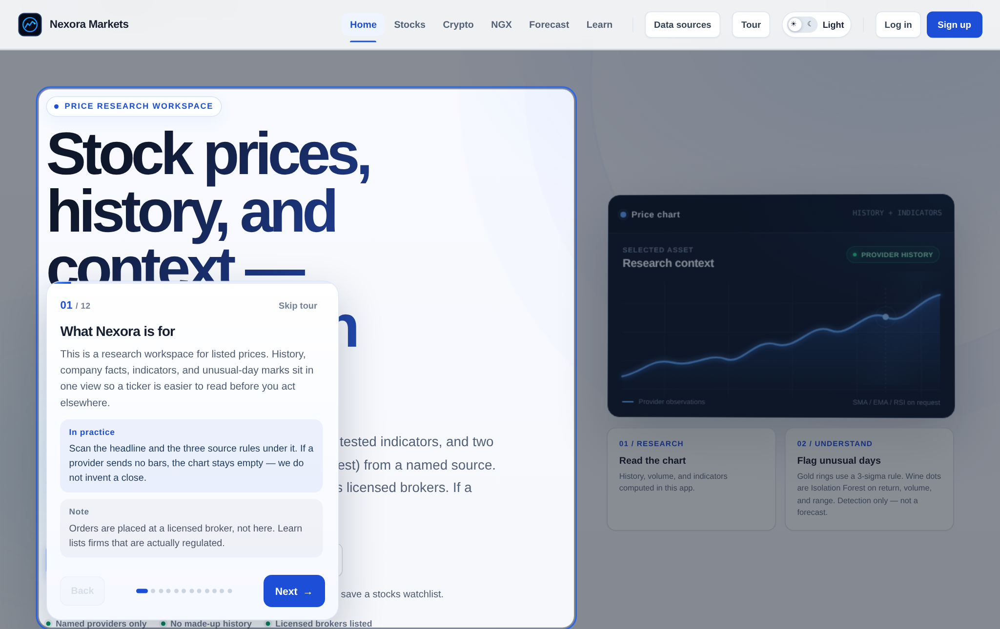

**Fig B.2:** Guided tour, first step

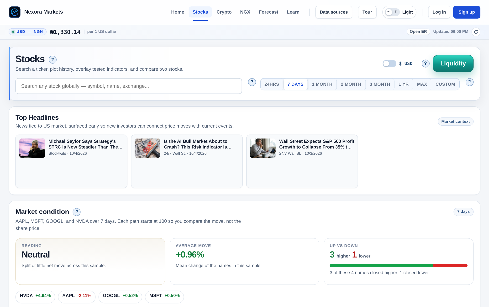

**Fig B.3:** Stocks page: search, headlines, and market condition


**Fig B.4:** US stock chart (AAPL) with indicators and unusual-day markers

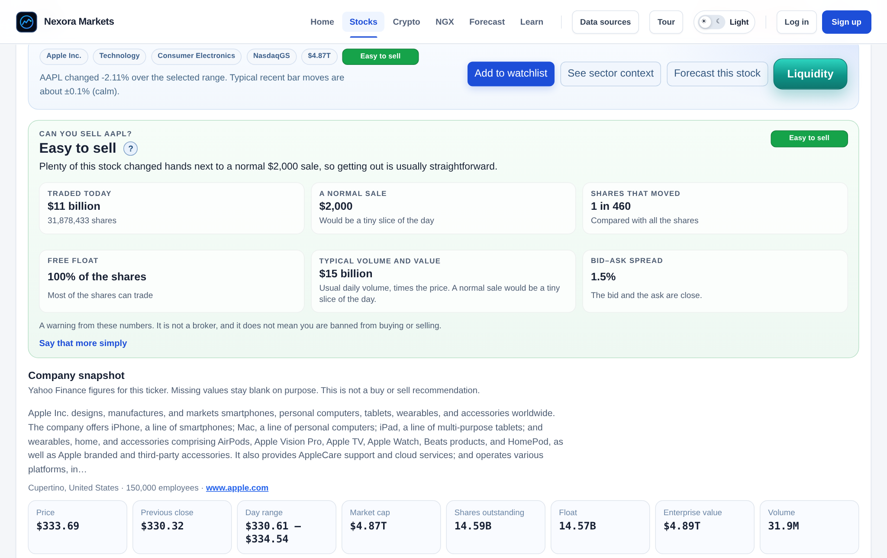

**Fig B.5:** AAPL summary: watchlist button, liquidity reading, and company snapshot

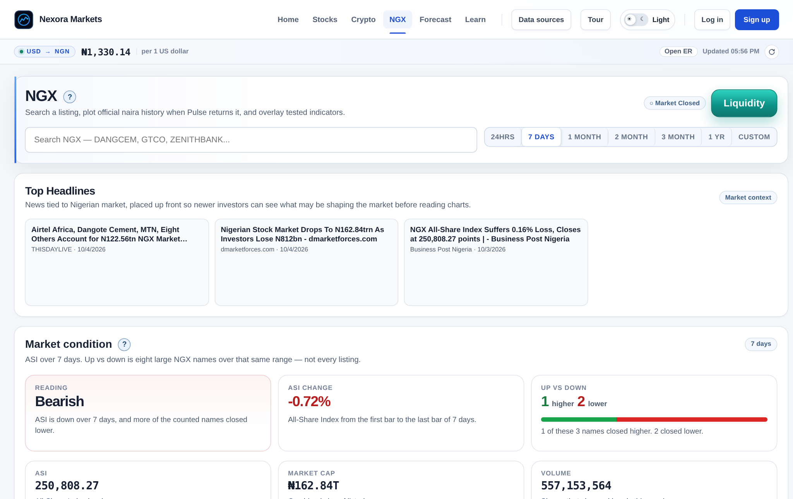

**Fig B.6:** NGX page: headlines and market condition

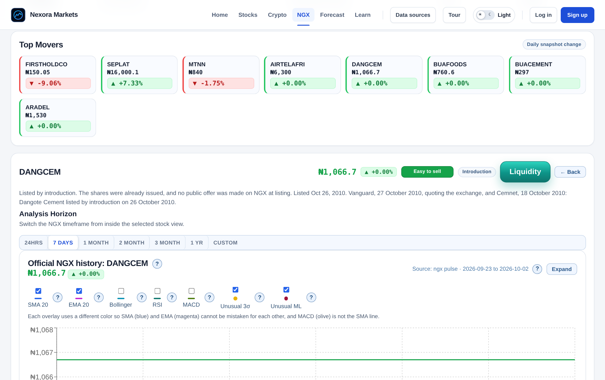

**Fig B.7:** NGX Top Movers and company page (DANGCEM) with liquidity and listing tags

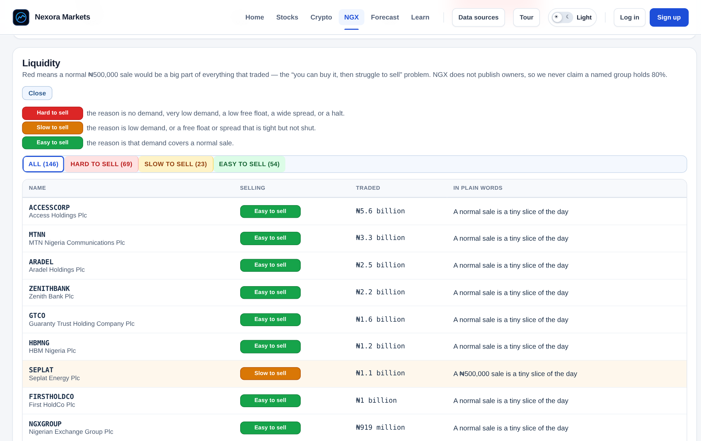

**Fig B.8:** NGX liquidity board with hard, slow, and easy to sell tags


**Fig B.9:** Forecast page, AAPL, 1 year

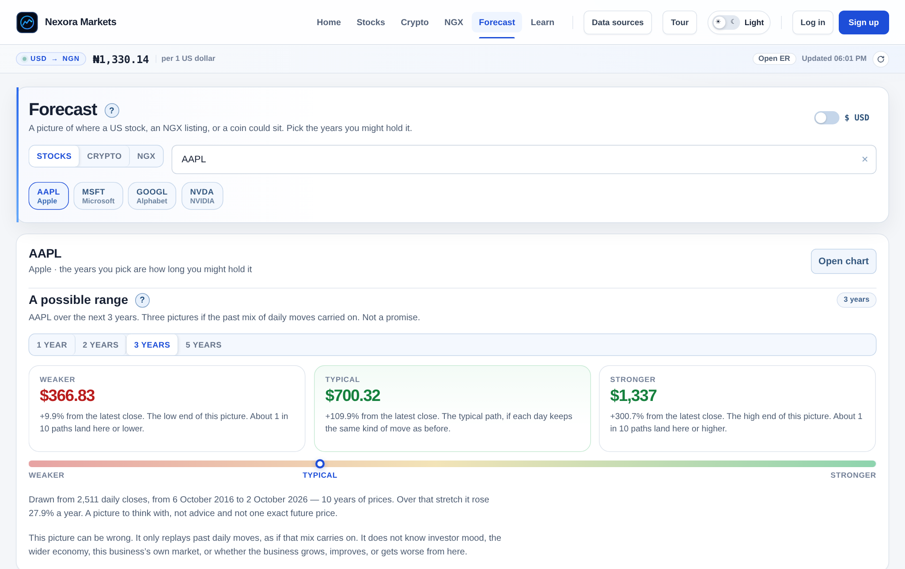

**Fig B.10:** Forecast page, AAPL, 3 years

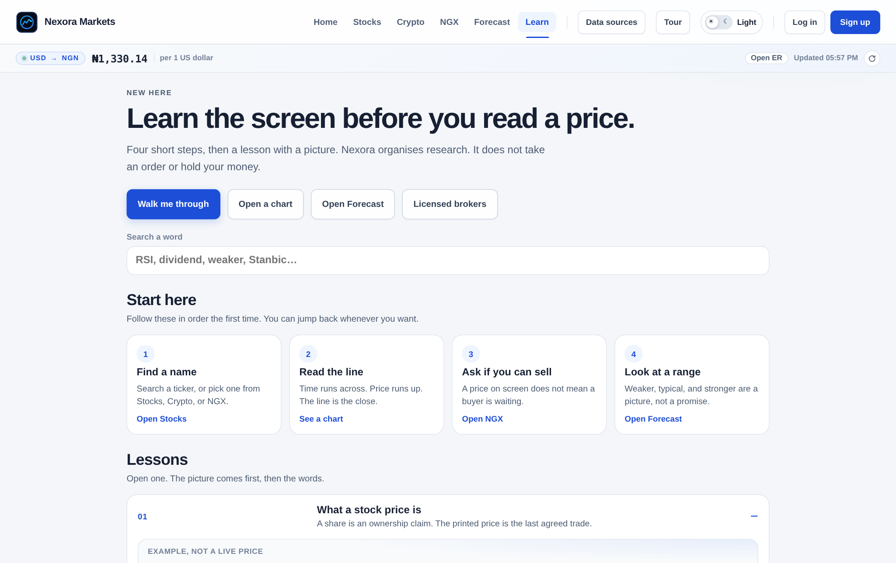

**Fig B.11:** Learn page, start-here path


**Fig B.12:** Learn page, earnings-report lesson open


**Fig B.13:** Log-in and sign-up form

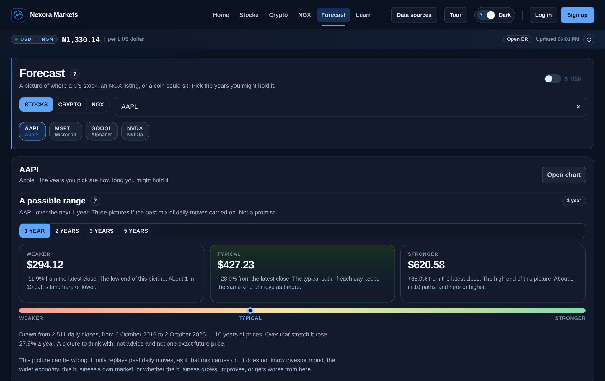

**Fig B.14:** Forecast page in dark theme

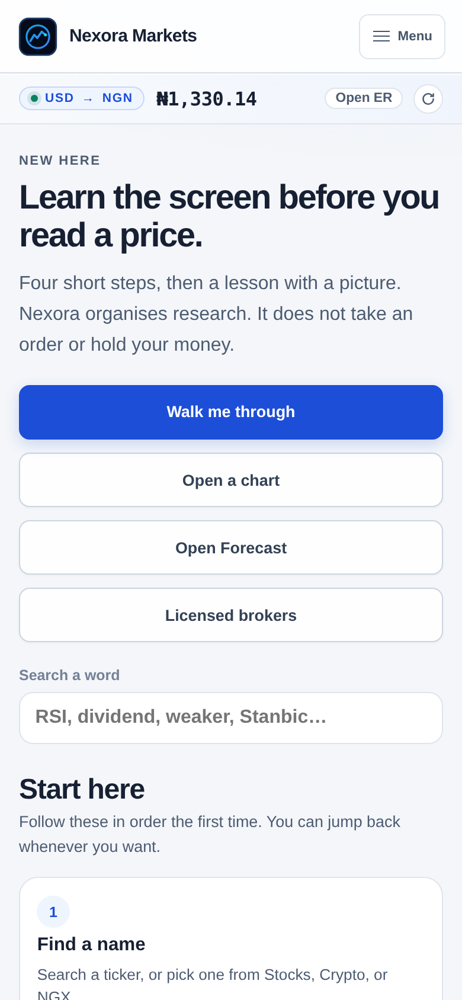

**Fig B.15:** Learn page on a phone-sized screen

> Not captured: the watchlist after logging in, because it needs a real account. Log in, add a stock with **Add to watchlist**, and insert that screen here if your supervisor wants it.
